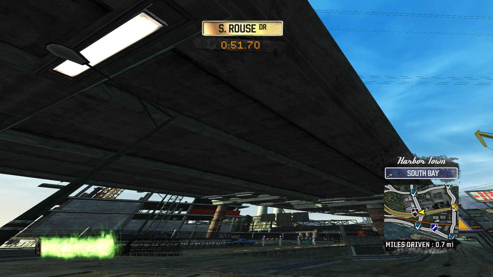

> [!IMPORTANT]
> **💬 DOWNLOAD & DISCUSSION**
>
> **[Join the Flat2VR Discord](https://discord.gg/P4q9zt7ek)** · **[Open the Burnout Paradise Remastered thread](https://discord.com/channels/747967102895390741/1566770303474864248)**
>
> Get the mod and share feedback in the game’s Flat2VR thread.

  

## 📦 INSTALLATION

1. Install **Burnout Paradise Remastered** on PC.
2. **Put the mod archive next to the game’s `.exe`.** Extract the complete archive there and keep the mod folder intact.
3. Connect your PC VR headset, select a 64-bit OpenXR runtime, and run **`RUN.bat`** from the extracted mod folder.

## ⚡ FEATURES

### 🏎️ Steer, drift and hit the boost with your controllers

Use the triggers for throttle and brake, the stick to steer, and the handbrake to swing the car around a corner. Hit boost as you straighten out.

### 👀 Look down side streets while you drive

Look to the side in your headset without moving the steering stick. Cycle the camera from your controller to change how you see the car and the road.

### 🔥 Watch exhaust and sunlight in stereo

Hit boost and see the exhaust behind the car in both eyes. Sun glare follows the light as you turn your head.

## 📸 In-game screenshots

  
  

[Tester credits](TESTERS.md)

## 🎮 Other VR mods

| VR mod | Highlights |
| --- | --- |
| [Alone in the Dark (2008) VR](https://github.com/Monsterdeadwood/AloneInTheDark2008VR) | Aim a light by hand, carry a chair, and throw bottles |
| [Battlefield 3: VRevamp](https://github.com/Monsterdeadwood/Battlefield-3-VRevamp) | Pull dropped guns toward you, draw from body slots, and fight through changing weather |
| [Crysis 2: VRevamp](https://github.com/Monsterdeadwood/C2VR) | Hit enemies with your fists or weapon, throw them with telekinesis, and swap weapon hands |
| [NOVA · CS:GO Legacy VR](https://github.com/Monsterdeadwood/CSGOVR) | Aim and feel recoil, take scoped shots, and buy gear from the controllers |
| [Metro 2033 VR](https://github.com/Monsterdeadwood/Metro2033VR) | Lift an enemy, shock them with your hand, or bounce a glowing core down a tunnel |
| [Rainbow Six Siege VR](https://github.com/Monsterdeadwood/SiegeVR) | Brace a rifle by its foregrip, drop prone and use gadgets |
| [Star Wars: The Force Unleashed II VR](https://github.com/Monsterdeadwood/TFU2VR) | Ignite two sabers independently, cut limbs, and ride a crate with the Force |
| [TimeShift VR](https://github.com/Monsterdeadwood/TimeShiftVR) | Punch or hit with your weapon, control time, and fight through changing weather |
| [Titanfall 1 VR](https://github.com/Monsterdeadwood/Titanfall1VR) | Call and board a Titan, catch shots with Vortex, and eject |
| [You Are Empty: Absolute Edition VR](https://github.com/Monsterdeadwood/YouAreEmptyAEVR) | Shoot with one hand, hit with either, and reach out against walls |
