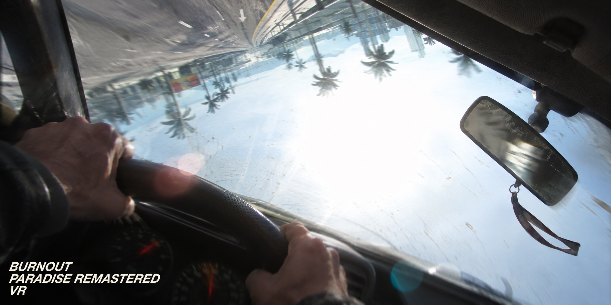

> [!IMPORTANT]
> **[TEST BUILDS & DISCUSSION · FLAT2VR DISCORD](https://discord.gg/P4q9zt7ek)**
> Testing, build requests, feedback and discussion happen in the **Flat2VR Modding Discord**. Join the server and find the **Burnout Paradise Remastered VR** thread.

  

# Burnout Paradise Remastered VR

[Flat2VR Discord](https://discord.gg/P4q9zt7ek) · [All projects](PORTFOLIO.md)

An experimental VR driving mod for Burnout Paradise Remastered. Drive through Paradise City with head-tracked stereo and VR vehicle menus. The current preview tests the projection of the original boost and sun effects in both eyes.

**Package baseline on this page: P36 Exhaust Projection Preview.**

## Installation

1. Get the current **Burnout Paradise Remastered VR** test package in the Burnout thread on Flat2VR.
2. Keep your supported game installed and extract the complete VR package into its own folder.
3. Connect PC VR, activate a compatible 64-bit OpenXR runtime and open **RUN.bat**.
4. If detection needs help, use RUN.bat --game followed by the quoted full path to BurnoutPR.exe. Use the supplied **STOP.bat** to close this launch.

Current test-package availability is coordinated in Discord. Use the complete package for your supported game build; this project page is separate from a release download.

## What this project brings to VR

- Stereoscopic driving and headset-controlled viewing.
- Native boost/exhaust particle projection corrected per eye in the P36 candidate.
- Restored native sun glare follows the world sun in both eyes.
- Vehicle menus share a VR plane while vehicle previews retain stereo depth.
- Motion-controller driving buttons, camera cycling and FSR 1 scaling.

<b>Controller quick reference</b>

| Input | Action |
| --- | --- |
| Right trigger / left trigger | Throttle / brake and reverse |
| Left stick | Steer |
| A / B | Boost / handbrake |
| Left X or Menu | Pause |
| Left stick click / right stick click | Recenter / cycle camera |
| Left grip | Temporarily show HUD |
| Menus: left stick, A/Y, B/X/Menu | Navigate, confirm, back |

The complete package control sheet takes precedence for its version and interaction profile.

## Features in newer test builds

- **Startup prompts in the headset.** P38 tested automatic confirmation through the loading screens and lets you take over with the controller.
- **Stereo returns after a stalled game frame.** P39 held the last complete stereo pair with its original poses during a 1.72-second test stall. Fresh stereo and driving input returned afterward in the XR Sim and Tape test.

## Current status

**Experimental preview.** Actual-game XR Sim/Tape boost comparisons and hardware GPU controls checked the admitted particle passes, both-eye constants and restoration.

- Physical-headset visual acceptance, all vehicle/exhaust variants, weather and device recreation remain open.

[Detailed status and validation scope](docs/PROJECT_STATUS.md)

## Testing & feedback

Post in the game’s [Flat2VR thread](https://discord.gg/P4q9zt7ek) with your **mod version, game/store version, headset, OpenXR runtime, GPU, reproduction steps and the package’s diagnostic ZIP**. A short video is helpful for visual or handling problems.

<!-- COMMUNITY_TESTERS_START -->
## ❤️ Community testers — thank you!

These VR projects improve thanks to the people sharing test reports, logs, videos and practical feedback across the portfolio.

alvaro · Arkturus [CODA] · Arkturus Primacronus [HD2M] · Arthur G [ORE] · Bestgamer3 · Chtiblue · creative name [SC℧M] · Derp Dog · DNana51 [R1Δ] · Gritt [F2VR] · headbangerle. · huligan01 · jeremiasadasmki · Kerin\_Serica [1984] · kilo · Lawyer [WYRD] · little\_boxbr · Lord Beardsteak · MeWhenINameMyself · MetalikSix · neoz\_1980 · Notagameaddict · Pelmeschka · Potato Pancake Person · ReseTV · Rusty Gere · SilentBang [LTS] · SilentVortigaunt · Terry · ThE LaNd GuLl · Thomas-3D-VR · Uruz [F2VR] · Willthethrill · wxorys\_ · Xavier H. G.

[Full community credits, games, feedback contributors and testing volunteers](TESTERS.md).

The linked list shows which games each person helped with. Thank you as well to everyone whose reports arrived without a public display name.

<!-- COMMUNITY_TESTERS_END -->

## Other VR mods by Monsterdeadwood

| Game / project | Focus | Visibility |
| --- | --- | --- |
| [Assassin’s Creed VR](https://github.com/Monsterdeadwood/AC1VR) | First-person exploration, tracked climbing and sword interaction | Private |
| [Crysis 2: VRevamp](https://github.com/Monsterdeadwood/C2VR) | Original Crysis 2 in VR with tracked weapons, physical melee and a spatial HUD | Public |
| [Star Wars: The Force Unleashed II VR](https://github.com/Monsterdeadwood/TFU2VR) | Tracked dual lightsabers, telekinesis and Force powers | Public |
| [NOVA · Counter-Strike: Global Offensive (Legacy) VR](https://github.com/Monsterdeadwood/CSGOVR) | Local 5v5 bot matches, motion-controlled aiming and haptics | Public |
| [TimeShift VR](https://github.com/Monsterdeadwood/TimeShiftVR) | Controller-driven time powers, tracked weapons and roomscale posture | Public |
| [You Are Empty: Absolute Edition VR](https://github.com/Monsterdeadwood/YouAreEmptyAEVR) | Absolute Edition with tracked weapons and melee with either hand | Public |
| [Alone in the Dark (2008) VR](https://github.com/Monsterdeadwood/AloneInTheDark2008VR) | Tracked items, wall contact and the original throw controls | Public |
| [Rainbow Six Siege VR](https://github.com/Monsterdeadwood/SiegeVR) | Shadow Legacy stereo and two-handed weapon handling | Public |
| [Titanfall 1 VR](https://github.com/Monsterdeadwood/Titanfall1VR) | R1Delta pilot aiming, stereo viewing and Titan cockpits | Public |
| [Metro 2033 VR](https://github.com/Monsterdeadwood/Metro2033VR) | Original Metro 2033 with tracked interaction and PhysX experiments | Public |
| [Insurgency VR](https://github.com/Monsterdeadwood/InsurgencyVR) | Early VR mod project for stereo rendering and the game camera | Private |
| [Counter-Strike: Source VR](https://github.com/Monsterdeadwood/CSSVR) | Early VR mod project for stereo rendering and head tracking | Private |

Private repository links are available to invited collaborators. Public project pages are marked above.

## Credits & development notes

Project maintained by [Monsterdeadwood](https://github.com/Monsterdeadwood). This is an independent fan VR project; you need your own supported copy of the original game.

Documentation reviewed: **14 November 2026**.
