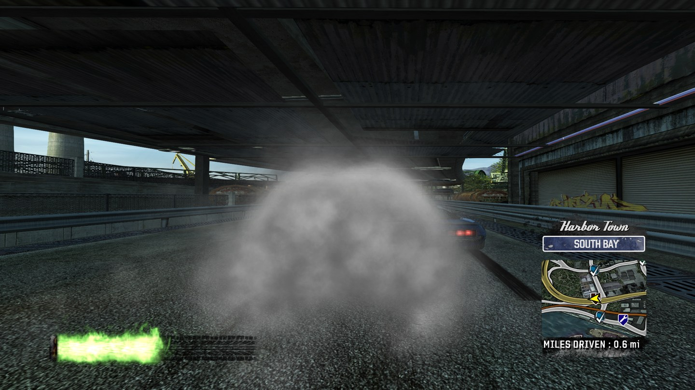

> [!IMPORTANT]
> **💬 TEST BUILDS & DISCUSSION**
>
> **[Join the Flat2VR Discord](https://discord.gg/P4q9zt7ek)** · **[Open the Burnout Paradise Remastered thread](https://discord.com/channels/747967102895390741/1566770303474864248)**
>
> Download the latest test build from the thread and share your results there.

  

## 📦 INSTALLATION

1. Install **Burnout Paradise Remastered** and request the matching VR test package.
2. Extract the complete mod into its own folder.
3. Connect your PC VR headset, select a 64-bit OpenXR runtime, and run **`RUN.bat`**.

## ⚡ FEATURES

### DRIVE THROUGH PARADISE CITY IN STEREO

Look around with your headset while driving. The vehicle selection screen keeps a flat menu and a stereoscopic car preview.

### BOOST FLAMES & SUN GLARE IN BOTH EYES

The P36 development build fixes the original boost and exhaust effects for stereo and lines up the sun glare in both eyes.

### THE VIEW RECOVERS AFTER A STALL

The P39 test held the last full stereo frame during a game stall and brought back fresh stereo as driving resumed.

The latest stereo effects were checked in XR Sim. Headset visuals still need testing.

## 📸 In-game screenshots

  
  

[Tester credits](TESTERS.md) · [Build details](docs/PROJECT_STATUS.md)

## 🎮 Other VR mods

- [Alone in the Dark (2008) VR](https://github.com/Monsterdeadwood/AloneInTheDark2008VR)
- [Battlefield 3: VRevamp](https://github.com/Monsterdeadwood/Battlefield-3-VRevamp)
- [Crysis 2: VRevamp](https://github.com/Monsterdeadwood/C2VR)
- [NOVA · CS:GO Legacy VR](https://github.com/Monsterdeadwood/CSGOVR)
- [Metro 2033 VR](https://github.com/Monsterdeadwood/Metro2033VR)
- [Rainbow Six Siege VR](https://github.com/Monsterdeadwood/SiegeVR)
- [Star Wars: The Force Unleashed II VR](https://github.com/Monsterdeadwood/TFU2VR)
- [TimeShift VR](https://github.com/Monsterdeadwood/TimeShiftVR)
- [Titanfall 1 VR](https://github.com/Monsterdeadwood/Titanfall1VR)
- [You Are Empty: Absolute Edition VR](https://github.com/Monsterdeadwood/YouAreEmptyAEVR)
