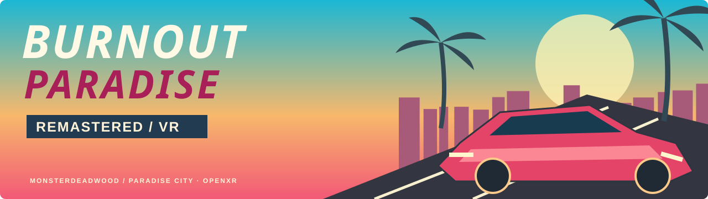

> [!IMPORTANT]
> **[ТЕСТИРОВАНИЕ И ОБСУЖДЕНИЕ · FLAT2VR DISCORD](https://discord.gg/P4q9zt7ek)**
> Тестирование, запрос сборок, отзывы и обсуждение проходят в **Flat2VR Modding Discord**. Перейди на сервер и найди тему **Burnout Paradise Remastered VR**.

# Burnout Paradise Remastered VR

[English](README.md) · [Русский](README_RU.md) · [Flat2VR Discord](https://discord.gg/P4q9zt7ek) · [All projects](PORTFOLIO.md)

Экспериментальное стереовождение по Paradise City в Burnout Paradise Remastered. Текущая сборка развивает трекинг головы, меню автомобилей и правильную проекцию штатных эффектов ускорения и солнца для каждого глаза.

**Текущая описанная ветка: P36 Exhaust Projection Preview.**

## Установка

1. Возьми текущую сборку **Burnout Paradise Remastered VR** в теме Burnout на Flat2VR.
2. Сохрани установленной поддерживаемую игру и распакуй полный VR-пакет в отдельную папку.
3. Подключи PC VR, включи совместимый 64-битный OpenXR runtime и открой **RUN.bat**.
4. Если игра не найдена, укажи после RUN.bat --game полный путь к BurnoutPR.exe в кавычках. Приложенный **STOP.bat** завершает этот запуск.

Доступность актуальных тестовых пакетов уточняется в Discord. Нужен полный пакет для поддерживаемой версии игры; страница проекта сама по себе не является скачиваемым релизом.

## Что есть в проекте

- Стереовождение и управление обзором шлемом.
- Исправленная проекция родных частиц ускорения/выхлопа для каждого глаза в P36.
- Восстановленные родные солнечные блики следуют за солнцем в обоих глазах.
- Меню автомобилей расположено на общей VR-плоскости, а предпросмотр машин сохраняет стереоглубину.
- Кнопки вождения на VR-контроллерах, смена камеры и масштабирование FSR 1.

<b>Краткое управление</b>

| Действие / кнопка | Назначение |
| --- | --- |
| Right trigger / left trigger | Газ / тормоз и задний ход |
| Left stick | Рулить |
| A / B | Ускорение / ручной тормоз |
| Left X or Menu | Пауза |
| Left stick click / right stick click | Сброс камеры / смена камеры |
| Left grip | Временно показать HUD |
| Menus: left stick, A/Y, B/X/Menu | Навигация, подтверждение, назад |

Полная инструкция управления в конкретной сборке учитывает её версию и профиль контроллеров.

## Текущий статус

**Экспериментальная сборка.** Сравнения ускорения в настоящей игре через XR Sim/Tape и GPU-контроли проверили поддерживаемые проходы частиц, константы обоих глаз и восстановление.

- Принятие изображения в физическом шлеме, все машины/варианты выхлопа, погода и пересоздание устройства ещё требуют проверки.

[Подробный статус и область проверки](docs/PROJECT_STATUS.md)

## Тестирование и отзывы

Напиши в [тему игры на Flat2VR](https://discord.gg/P4q9zt7ek): укажи **версию мода, игру/магазин, шлем, OpenXR runtime, GPU, шаги воспроизведения и диагностический ZIP сборки**. Для проблем изображения или управления полезно короткое видео.

## Другие мои VR-моды

| Игра / проект | Направление | Доступ |
| --- | --- | --- |
| [Assassin’s Creed VR](https://github.com/Monsterdeadwood/AC1VR) | Обзор от первого лица, лазание и меч | Закрытый |
| [Crysis 2 VR](https://github.com/Monsterdeadwood/C2VR) | Нанокостюм, физическое взаимодействие и интерфейс | Закрытый |
| [NOVA · CS:GO Legacy VR](https://github.com/Monsterdeadwood/CSGOVR) | Локальные матчи CS:GO Legacy с VR-управлением | Закрытый |
| [TimeShift VR](https://github.com/Monsterdeadwood/TimeShiftVR) | Управление временем, девять видов оружия и позы | Закрытый |
| [You Are Empty: Absolute Edition VR](https://github.com/Monsterdeadwood/YouAreEmptyAEVR) | Absolute Edition в VR, оружие и взаимодействие | Открытый |
| [Alone in the Dark 2008 VR](https://github.com/Monsterdeadwood/AloneInTheDark2008VR) | VR-хоррор и взаимодействие с предметами | Открытый |
| [Rainbow Six Siege VR](https://github.com/Monsterdeadwood/SiegeVR) | Стерео и оружие от контроллеров в старой Siege | Открытый |
| [Titanfall 1 VR](https://github.com/Monsterdeadwood/Titanfall1VR) | Бой пилота и кабины титанов | Закрытый |
| [Metro 2033 VR](https://github.com/Monsterdeadwood/Metro2033VR) | Оригинальная Metro в VR и нативная физика | Открытый |
| [Insurgency VR](https://github.com/Monsterdeadwood/InsurgencyVR) | Начальная подготовка VR-интеграции | Закрытый |
| [Counter-Strike: Source VR](https://github.com/Monsterdeadwood/CSSVR) | Разработка VR для Counter-Strike: Source | Закрытый |

Ссылки на закрытые репозитории доступны приглашённым участникам. Открытые страницы отмечены в таблице.

## Авторство и заметки разработки

Проект ведёт [Monsterdeadwood](https://github.com/Monsterdeadwood). Это независимый фанатский VR-проект; нужна собственная поддерживаемая копия оригинальной игры.

Описание сверено: **14 ноября 2026 года**.
